# ☁️ 90 Days of Cloud Engineering

**Go from zero to job-ready junior cloud engineer — completely free, at your own pace.**

[](https://github.com/ahmadjawad533/90-days-of-cloud-engineering/stargazers)
[](https://github.com/ahmadjawad533/90-days-of-cloud-engineering/network/members)
[](LICENSE)
[](LICENSE-CONTENT.md)
[](CONTRIBUTING.md)
[](https://github.com/ahmadjawad533/90-days-of-cloud-engineering)
[-black?logo=x)](https://twitter.com/intent/tweet?text=Leveling%20up%20my%20cloud%20skills%20with%20the%20free%2090%20Days%20of%20Cloud%20Engineering%20roadmap!%20Check%20it%20out:%20https://github.com/ahmadjawad533/90-days-of-cloud-engineering%20%2390DaysOfCloudEngineering)
[](https://www.linkedin.com/sharing/share-offsite/?url=https://github.com/ahmadjawad533/90-days-of-cloud-engineering)

> 🌟 **Support Free Cloud Education:** If this roadmap helps your learning or career, please consider giving it a **Star ⭐**! It helps others discover this free curriculum and keeps the project growing.

---

### 🌐 Interactive Web Portal Available
Prefer learning through a modern interactive web dashboard?
- 🖥️ **Web Application**: Check out [90-days-of-cloud-engineering-web](https://github.com/ahmadjawad533/90-days-of-cloud-engineering-web)
- Features: Real-time progress tracking saved to browser storage, copyable CLI cheatsheets, filterable glossary, and 70+ flashcard interview questions!

---

## 🎯 What Is This?

A structured, self-paced, 90-day roadmap that teaches you cloud engineering from scratch. By the end you will be able to **design, deploy, secure, monitor and tear down** a production-style application on the cloud using Infrastructure as Code and CI/CD — and you will have a **portfolio project** to show employers.

**Primary cloud:** AWS (with Azure and GCP equivalents noted on every cloud-specific day).

## 👋 Who Is This For?

- Complete beginners curious about cloud
- Career switchers moving into tech
- Sysadmins and IT pros adding cloud skills
- Students preparing for internships or junior roles
- Self-taught developers who want to learn infrastructure

**Prerequisites:** A laptop, a GitHub account, an AWS free-tier account, and 1-2 hours per day. That's it.

> **Day numbers are a guide, not a deadline.** Take your time, repeat days, and learn at your own pace.

## 🏗️ What You Will Build

By day 90, you will have built all of this — hands-on:

- 🌐 Written explanation of what happens when you open a URL
- 🐧 Linux backup and health-check scripts
- 🔀 A fork-branch-PR Git workflow on your own repo
- 🐍 Python scripts that automate cloud resources with boto3
- ☁️ A three-tier app on a hand-built AWS VPC
- 🐳 A containerized app pushed to a registry
- ☸️ An app deployed to a Kubernetes cluster
- 🏗️ Your entire infrastructure rebuilt with Terraform
- 🚀 A full CI/CD pipeline with GitHub Actions
- 📊 Monitoring dashboards and working alerts
- 🔒 A security review and cost report
- 🎓 **Capstone:** An end-to-end production-style project, fully documented

---

## 🗺️ Visual Roadmap

```mermaid
flowchart LR
    A["Days 1-7\nCloud &\nNetworking"] --> B["Days 8-18\nLinux &\nShell"]
    B --> C["Days 19-24\nGit &\nGitHub"]
    C --> D["Days 25-31\nPython &\nBoto3"]
    D --> E["Days 32-40\nCore AWS\nServices"]
    E --> F["Days 41-47\nContainers &\nDocker"]
    F --> G["Days 48-56\nKubernetes"]
    G --> H["Days 57-64\nTerraform &\nAnsible"]
    H --> I["Days 65-71\nCI/CD"]
    I --> J["Days 72-77\nMonitoring &\nObservability"]
    J --> K["Days 78-83\nSecurity &\nCost"]
    K --> L["Days 84-90\nCapstone\nProject"]
    L --> M["Days 91-95\nBonus:\nCerts & Career"]

    style A fill:#4A90D9,color:#fff
    style B fill:#7B68EE,color:#fff
    style C fill:#E67E22,color:#fff
    style D fill:#2ECC71,color:#fff
    style E fill:#FF6B35,color:#fff
    style F fill:#0DB7ED,color:#fff
    style G fill:#326CE5,color:#fff
    style H fill:#844FBA,color:#fff
    style I fill:#2088FF,color:#fff
    style J fill:#E6522C,color:#fff
    style K fill:#D32F2F,color:#fff
    style L fill:#FFD700,color:#000
    style M fill:#00C853,color:#fff
```



---

## 📚 Full Curriculum

> Click any day to jump straight to the lesson. Each day takes approximately 60-120 minutes.

### Module 1: Cloud & Networking Fundamentals (Days 1-7)

| Day | Topic |
|:---:|:---|
| [Day 1](days/day-01-what-is-cloud/README.md) | What Is Cloud Computing |
| [Day 2](days/day-02-cloud-service-models/README.md) | Cloud Service Models (IaaS, PaaS, SaaS) |
| [Day 3](days/day-03-how-the-internet-works/README.md) | How the Internet Works (DNS, HTTP) |
| [Day 4](days/day-04-tcp-ip-and-osi-model/README.md) | TCP/IP and the OSI Model |
| [Day 5](days/day-05-ip-subnets-cidr/README.md) | IP Addresses, Subnets, and CIDR |
| [Day 6](days/day-06-load-balancing-and-cdns/README.md) | Load Balancing and CDNs |
| [Day 7](days/day-07-networking-review-project/README.md) | Cloud Networking Review and Project |

### Module 2: Linux & Shell Scripting (Days 8-18)

| Day | Topic |
|:---:|:---|
| [Day 8](days/day-08-intro-to-linux/README.md) | Introduction to Linux |
| [Day 9](days/day-09-linux-filesystem/README.md) | Linux File System and Navigation |
| [Day 10](days/day-10-file-permissions/README.md) | File Permissions and Ownership |
| [Day 11](days/day-11-users-groups-sudo/README.md) | Users, Groups, and sudo |
| [Day 12](days/day-12-package-management/README.md) | Package Management |
| [Day 13](days/day-13-processes-monitoring/README.md) | Processes and System Monitoring |
| [Day 14](days/day-14-text-processing/README.md) | Text Processing (grep, sed, awk) |
| [Day 15](days/day-15-shell-scripting-basics/README.md) | Shell Scripting Basics |
| [Day 16](days/day-16-variables-control-flow/README.md) | Shell Scripting Variables and Control Flow |
| [Day 17](days/day-17-functions-debugging/README.md) | Shell Scripting Functions and Debugging |
| [Day 18](days/day-18-backup-script/README.md) | Build a Backup Script |

### Module 3: Git & GitHub (Days 19-24)

| Day | Topic |
|:---:|:---|
| [Day 19](days/day-19-intro-to-git/README.md) | Introduction to Git |
| [Day 20](days/day-20-branching-merging/README.md) | Git Branching and Merging |
| [Day 21](days/day-21-remote-repos-github/README.md) | Remote Repositories and GitHub |
| [Day 22](days/day-22-pull-requests/README.md) | Pull Requests and Code Review |
| [Day 23](days/day-23-git-workflows/README.md) | Git Workflows and Best Practices |
| [Day 24](days/day-24-merge-conflicts/README.md) | Resolve Merge Conflicts |

### Module 4: Python for Cloud (Days 25-31)

| Day | Topic |
|:---:|:---|
| [Day 25](days/day-25-python-basics/README.md) | Python Basics for Cloud |
| [Day 26](days/day-26-python-data-structures/README.md) | Python Data Structures |
| [Day 27](days/day-27-file-io-error-handling/README.md) | Python File I/O and Error Handling |
| [Day 28](days/day-28-modules-virtualenvs/README.md) | Python Modules and Virtual Environments |
| [Day 29](days/day-29-intro-to-boto3/README.md) | Introduction to Boto3 |
| [Day 30](days/day-30-boto3-ec2-s3/README.md) | Boto3 EC2 and S3 Operations |
| [Day 31](days/day-31-cloud-resource-tagger/README.md) | Build a Cloud Resource Tagger |

### Module 5: Core AWS Services (Days 32-40)

| Day | Topic |
|:---:|:---|
| [Day 32](days/day-32-aws-iam/README.md) | AWS IAM Deep Dive |
| [Day 33](days/day-33-vpc-fundamentals/README.md) | AWS VPC Fundamentals |
| [Day 34](days/day-34-subnets-routes-gateways/README.md) | VPC Subnets, Route Tables, and Gateways |
| [Day 35](days/day-35-security-groups-nacls/README.md) | Security Groups and NACLs |
| [Day 36](days/day-36-launch-ec2/README.md) | Launch an EC2 Instance |
| [Day 37](days/day-37-ec2-storage/README.md) | EC2 Storage (EBS and Instance Store) |
| [Day 38](days/day-38-s3-buckets/README.md) | S3 Buckets and Objects |
| [Day 39](days/day-39-rds-databases/README.md) | RDS and Managed Databases |
| [Day 40](days/day-40-three-tier-vpc/README.md) | Build a Three-Tier VPC Architecture |

### Module 6: Containers & Docker (Days 41-47)

| Day | Topic |
|:---:|:---|
| [Day 41](days/day-41-what-are-containers/README.md) | What Are Containers? |
| [Day 42](days/day-42-docker-basics/README.md) | Docker Installation and Basics |
| [Day 43](days/day-43-dockerfiles/README.md) | Dockerfiles and Building Images |
| [Day 44](days/day-44-docker-networking-volumes/README.md) | Docker Networking and Volumes |
| [Day 45](days/day-45-docker-compose/README.md) | Docker Compose |

### Module 7: Kubernetes (Days 46-56)

| Day | Topic |
|:---:|:---|
| [Day 46](days/day-46-container-registries/README.md) | Container Registries (ECR, Docker Hub) |
| [Day 47](days/day-47-multi-stage-builds/README.md) | Multi-Stage Builds and Best Practices |
| [Day 48](days/day-48-what-is-kubernetes/README.md) | What Is Kubernetes? |
| [Day 49](days/day-49-kubernetes-architecture/README.md) | Kubernetes Architecture |
| [Day 50](days/day-50-pods-replicasets-deployments/README.md) | Pods, ReplicaSets, and Deployments |
| [Day 51](days/day-51-services-networking/README.md) | Services and Networking in Kubernetes |
| [Day 52](days/day-52-configmaps-secrets-storage/README.md) | ConfigMaps, Secrets, and Storage |
| [Day 53](days/day-53-managed-kubernetes-eks/README.md) | Managed Kubernetes (EKS Overview) |
| [Day 54](days/day-54-deploy-to-eks/README.md) | Deploy an App to EKS |
| [Day 55](days/day-55-helm-charts/README.md) | Helm Charts Introduction |
| [Day 56](days/day-56-kubernetes-troubleshooting/README.md) | Kubernetes Troubleshooting |

### Module 8: Infrastructure as Code (Days 57-64)

| Day | Topic |
|:---:|:---|
| [Day 57](days/day-57-what-is-iac/README.md) | What Is Infrastructure as Code? |
| [Day 58](days/day-58-terraform-basics/README.md) | Terraform Installation and Basics |
| [Day 59](days/day-59-terraform-providers-resources/README.md) | Terraform Providers and Resources |
| [Day 60](days/day-60-terraform-variables-outputs/README.md) | Terraform Variables and Outputs |
| [Day 61](days/day-61-terraform-state/README.md) | Terraform State Management |
| [Day 62](days/day-62-terraform-modules/README.md) | Terraform Modules |
| [Day 63](days/day-63-rebuild-vpc-terraform/README.md) | Rebuild Your VPC with Terraform |
| [Day 64](days/day-64-intro-to-ansible/README.md) | Introduction to Ansible |

### Module 9: CI/CD (Days 65-71)

| Day | Topic |
|:---:|:---|
| [Day 65](days/day-65-what-is-cicd/README.md) | What Is CI/CD? |
| [Day 66](days/day-66-github-actions-basics/README.md) | GitHub Actions Basics |
| [Day 67](days/day-67-ci-pipeline/README.md) | Building a CI Pipeline |
| [Day 68](days/day-68-cd-pipeline/README.md) | Building a CD Pipeline |
| [Day 69](days/day-69-pipeline-security/README.md) | Pipeline Security and Secrets |
| [Day 70](days/day-70-automated-testing/README.md) | Automated Testing in Pipelines |
| [Day 71](days/day-71-capstone-pipeline/README.md) | Pipeline for the Capstone App |

### Module 10: Monitoring & Observability (Days 72-77)

| Day | Topic |
|:---:|:---|
| [Day 72](days/day-72-intro-to-monitoring/README.md) | Introduction to Monitoring |
| [Day 73](days/day-73-cloudwatch/README.md) | AWS CloudWatch Deep Dive |
| [Day 74](days/day-74-prometheus/README.md) | Introduction to Prometheus |
| [Day 75](days/day-75-grafana/README.md) | Grafana Dashboards |
| [Day 76](days/day-76-log-management/README.md) | Log Management and Analysis |
| [Day 77](days/day-77-alerts-incident-response/README.md) | Building Alerts and Incident Response |

### Module 11: Security & Cost Control (Days 78-83)

| Day | Topic |
|:---:|:---|
| [Day 78](days/day-78-cloud-security-fundamentals/README.md) | Cloud Security Fundamentals |
| [Day 79](days/day-79-iam-least-privilege/README.md) | IAM Least Privilege and Policies |
| [Day 80](days/day-80-secrets-management/README.md) | Secrets Management |
| [Day 81](days/day-81-container-scanning/README.md) | Container and Image Scanning |
| [Day 82](days/day-82-cost-optimization/README.md) | Cloud Cost Optimization |
| [Day 83](days/day-83-tagging-cost-reports/README.md) | Tagging Strategies and Cost Reports |

### Module 12: Capstone Project (Days 84-90)

| Day | Topic |
|:---:|:---|
| [Day 84](days/day-84-capstone-kickoff/README.md) | Capstone Project Kickoff |
| [Day 85](days/day-85-capstone-architecture/README.md) | Capstone Architecture Design |
| [Day 86](days/day-86-capstone-infra-code/README.md) | Capstone Infrastructure Code |
| [Day 87](days/day-87-capstone-app-deployment/README.md) | Capstone Application Deployment |
| [Day 88](days/day-88-capstone-cicd/README.md) | Capstone CI/CD Pipeline |
| [Day 89](days/day-89-capstone-monitoring-security/README.md) | Capstone Monitoring and Security |
| [Day 90](days/day-90-capstone-docs-presentation/README.md) | Capstone Documentation and Presentation |

### Bonus: Certifications & Careers (Days 91-95)

| Day | Topic |
|:---:|:---|
| [Day 91](days/day-91-aws-certification-paths/README.md) | AWS Certification Paths |
| [Day 92](days/day-92-study-strategies/README.md) | Study Strategies and Practice Exams |
| [Day 93](days/day-93-cloud-resume/README.md) | Building Your Cloud Resume |
| [Day 94](days/day-94-interview-prep/README.md) | Interview Preparation |
| [Day 95](days/day-95-whats-next/README.md) | What's Next and Continuing Education |

---

## 💰 Will This Cost Money?

**Target: \$0.** The entire curriculum is designed to stay within the AWS Free Tier if you follow the teardown steps after each lab. Read the [Cloud Cost Safety Guide](START_HERE.md#%EF%B8%8F-cloud-cost-safety-guide-critical---read-before-day-1) before you start.

Some resources marked with 💳 have optional paid tiers — you never need to pay to complete this program.

---

## 🚀 Getting Started

1. **Read** [START_HERE.md](START_HERE.md) — covers prerequisites, cost safety, and how to use the repo
2. **Fork** this repo to your GitHub account
3. **Clone** it locally:
   ```bash
   git clone https://github.com/<your-username>/90-days-of-cloud-engineering.git
   cd 90-days-of-cloud-engineering
   ```
4. **Open** [PROGRESS_TRACKER.md](PROGRESS_TRACKER.md) and start checking boxes
5. **Begin** [Day 1](days/day-01-what-is-cloud/README.md)

---

## 📣 Share Your Journey (#90DaysOfCloudEngineering)

Learning in public accelerates your growth, builds your network, and catches the eye of hiring managers! 

Post your daily or weekly milestones on **LinkedIn** and **X (Twitter)** using the hashtag **`#90DaysOfCloudEngineering`**:

- **🚀 Kickoff Post Template**:
  > *"I am officially starting the #90DaysOfCloudEngineering challenge created by @ahmadjawad533! ☁️ Over the next 90 days, I'll be mastering Linux, networking, Python, AWS, Docker, Kubernetes, Terraform, and CI/CD from scratch. Follow my journey: https://github.com/ahmadjawad533/90-days-of-cloud-engineering"*
- **📌 Daily Milestone Post Template**:
  > *"Day X/90 of #90DaysOfCloudEngineering: Today I learned [Topic] and built [Lab Name]! Key takeaway: [1 practical lesson]. Here's my GitHub repo: [link] 🚀"*

[](https://twitter.com/intent/tweet?text=I%20am%20officially%20taking%20on%20the%20%2390DaysOfCloudEngineering%20challenge!%20Leveling%20up%20from%20zero%20to%20job-ready%20cloud%20engineer%20for%20free:%20https://github.com/ahmadjawad533/90-days-of-cloud-engineering)
[](https://www.linkedin.com/sharing/share-offsite/?url=https://github.com/ahmadjawad533/90-days-of-cloud-engineering)

---

## 🤝 Contributing

Contributions are welcome! Whether it's fixing a typo, updating a broken link, adding a resource, or translating content — every contribution helps.

- **5-minute fix:** See a broken link? Follow our [quick-fix guide](CONTRIBUTING.md#-quick-wins-fix-something-in-5-minutes) to submit a PR in minutes.
- **Bigger contribution:** Read our full [Contributing Guide](CONTRIBUTING.md).
- **Report an issue:** Use our [issue templates](.github/ISSUE_TEMPLATE/).

---

## 📁 Repository Structure

```
90-days-of-cloud-engineering/
├── README.md                  ← You are here
├── START_HERE.md               ← Prerequisites, cost safety, setup
├── PROGRESS_TRACKER.md         ← Checkbox tracker for all 95 days
├── CONTRIBUTING.md             ← How to contribute
├── CODE_OF_CONDUCT.md          ← Community guidelines
├── LICENSE                     ← MIT (code)
├── LICENSE-CONTENT.md          ← CC BY 4.0 (written content)
├── ROADMAP.md                  ← Project roadmap
├── CHANGELOG.md                ← Version history
├── days/                       ← One folder per day (95 total)
│   ├── day-01-what-is-cloud/
│   ├── day-02-cloud-service-models/
│   └── ...
├── projects/
│   ├── capstone/               ← Capstone spec, architecture, rubric
│   └── mini-projects/          ← Smaller project ideas
├── labs/                       ← Dockerfiles, Terraform, Ansible, K8s manifests
├── resources/
│   ├── cheatsheets/            ← Linux, Git, Docker, kubectl, Terraform, AWS CLI
│   ├── certifications.md       ← Certification guide
│   ├── interview-questions.md  ← 60+ questions with answers
│   ├── glossary.md             ← Cloud engineering terms A-Z
│   └── needs-verification.md   ← Unverified links (help us check them!)
├── translations/               ← Community translations
└── .github/
    ├── ISSUE_TEMPLATE/         ← Bug, broken link, new resource, new topic
    ├── PULL_REQUEST_TEMPLATE.md
    ├── CODEOWNERS
    ├── dependabot.yml
    └── workflows/              ← Link checker, linting, validation
```

---

## ❓ FAQ

<details>
<summary><strong>Do I need any prior experience?</strong></summary>

No. This program starts from absolute zero. If you can use a web browser and are willing to learn, you are ready.
</details>

<details>
<summary><strong>Will this cost me money?</strong></summary>

The goal is $0. All labs are designed for the AWS Free Tier. Some days mention optional paid resources (marked with 💳), but you never need them to complete the curriculum. Always follow the teardown steps.
</details>

<details>
<summary><strong>Do I really need to do one day per day?</strong></summary>

No! The "90 days" is a framework, not a deadline. Some people finish in 60 days, some take 6 months. Go at whatever pace works for your life.
</details>

<details>
<summary><strong>Why AWS and not Azure or GCP?</strong></summary>

AWS has the largest market share, the most job postings, and a generous free tier — making it the best starting point. Every cloud-specific day includes Azure and GCP service mappings and links so you can easily transfer your knowledge.
</details>

<details>
<summary><strong>Can I use this to prepare for certifications?</strong></summary>

Yes! The curriculum aligns well with the AWS Cloud Practitioner (CLF-C02) and AWS Solutions Architect Associate (SAA-C03). Days 91-95 cover certification paths, study strategies, and practice exams.
</details>

<details>
<summary><strong>I found a broken link or mistake. What do I do?</strong></summary>

Thank you! Please [open an issue](https://github.com/ahmadjawad533/90-days-of-cloud-engineering/issues/new/choose) using the "Broken Link" or "Bug" template, or submit a PR with the fix. See [CONTRIBUTING.md](CONTRIBUTING.md) for details.
</details>

<details>
<summary><strong>Can I use this content for my blog, course, or company training?</strong></summary>

Yes! Code is MIT-licensed and written content is CC BY 4.0. Just give attribution. See [LICENSE](LICENSE) and [LICENSE-CONTENT.md](LICENSE-CONTENT.md).
</details>

<details>
<summary><strong>How do I get help when I'm stuck?</strong></summary>

1. Re-read the day's resources and commands carefully.
2. Search the official documentation (linked in every day file).
3. Open an issue in this repository describing what you tried.
4. Check Stack Overflow for the specific error message.
</details>

---

## ⭐ Show Your Support

If this repo helped you, please give it a ⭐ star! It helps others discover the project.

Share your progress on social media with **#90DaysOfCloudEngineering** — we would love to see what you are building!

---

## 📄 License

- **Code** (scripts, Terraform, Dockerfiles, manifests): [MIT License](LICENSE)
- **Written content** (lessons, guides, cheatsheets): [CC BY 4.0](LICENSE-CONTENT.md)

---

<p align="center">
  Made with ❤️ by the open-source community<br>
  <a href="START_HERE.md">Start your journey →</a>
</p>
