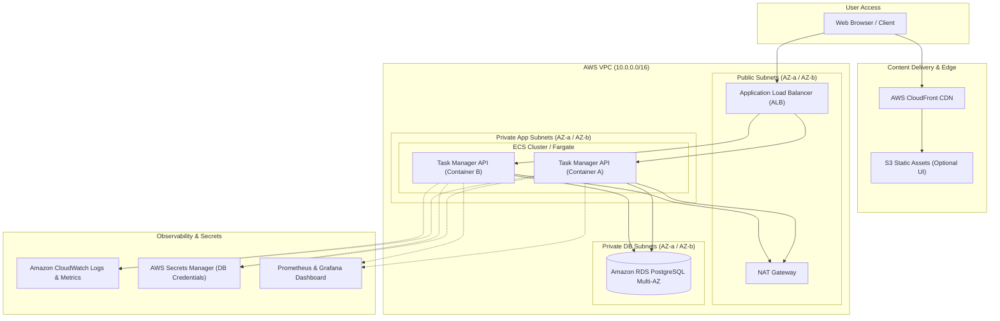

# Capstone Project: Cloud-Native Task Manager

A production-grade, three-tier web application deployed on AWS using everything learned across the 90 Days of Cloud Engineering curriculum.

---

## Overview

The **Cloud-Native Task Manager** brings together Linux system administration, networking, Docker containerization, Infrastructure as Code with Terraform, CI/CD automation with GitHub Actions, AWS cloud services, observability, and container security into a cohesive end-to-end portfolio project.

Learners build, containerize, provision, deploy, monitor, and document a multi-tier task management application running on AWS.



---

## Architecture Components

1. **Frontend**: Static single-page interface or client calls served via CloudFront + S3, or rendered through the backend application container.
2. **Backend**: Python Flask REST API running in Docker containers orchestrated on AWS ECS (Fargate) or Amazon EKS behind an Application Load Balancer (ALB).
3. **Database**: PostgreSQL hosted on Amazon RDS in private database subnets with automated snapshots and migrations.
4. **Networking**: Custom VPC with public, private application, and private data subnets across two Availability Zones, managed route tables, Internet Gateway, and NAT Gateway.
5. **Infrastructure as Code**: 100% Terraform with reusable root and child modules (`vpc`, `security-groups`, `rds`, `ecs`, `monitoring`), remote state locking with S3 and DynamoDB.
6. **CI/CD Pipeline**: GitHub Actions workflow testing code, running linter checks, scanning Docker images with Trivy, pushing images to Amazon ECR, and executing Terraform deployments.
7. **Observability**: AWS CloudWatch metrics/alarms, structured JSON logging, and Prometheus-compatible metrics endpoint exposed for Grafana dashboards.
8. **Security**: IAM least-privilege task execution roles, database credentials stored in AWS Secrets Manager, strict security groups with minimal ingress, and container vulnerability scanning.

---

## Must-Have Requirements

Each project submission must satisfy the following 10 criteria:

1. **Infrastructure as Code (Terraform)**:
   - All AWS resources (VPC, subnets, route tables, security groups, RDS, ECS/Fargate, ALB, IAM roles) defined in Terraform.
   - Modular structure with no hardcoded credentials or environment-specific values.
2. **Application Containerization**:
   - Multi-stage production `Dockerfile` following best practices (non-root user, slim base image, optimized layer caching).
   - Working `docker-compose.yml` for zero-configuration local development.
3. **CI/CD Pipeline**:
   - GitHub Actions workflow triggering on push and pull requests to `main`.
   - Pipeline stages: Linting (`flake8`/`black`), Automated Unit Tests (`pytest`), Container Vulnerability Scanning (`trivy`), Container Build & Push to Amazon ECR, and Deployment trigger.
4. **CRUD REST API**:
   - Working REST API endpoints with status codes, error validation, and JSON responses:
     - `GET /health` (Liveness & readiness probe)
     - `GET /api/v1/tasks` (List tasks)
     - `POST /api/v1/tasks` (Create new task)
     - `GET /api/v1/tasks/{id}` (Get single task)
     - `PUT /api/v1/tasks/{id}` (Update existing task status/details)
     - `DELETE /api/v1/tasks/{id}` (Delete task)
5. **Database with Schema Migrations**:
   - PostgreSQL relational schema storing tasks with title, description, status, and timestamps.
   - Scripted migration mechanism executed on startup or deployment.
6. **Monitoring & Observability Dashboard**:
   - Dashboard displaying at least 3 distinct metrics: HTTP request rate/latency, CPU/memory utilization, and database connection pool count.
7. **Working Alerting**:
   - At least 1 functional alert rule (e.g., CloudWatch Alarm or Prometheus Alertmanager) notifying via Amazon SNS (email/Slack webhook) when error rates exceed 5% or API health checks fail.
8. **Security Review Document**:
   - Documented security posture (`docs/security-review.md`) covering IAM role boundaries, encryption at rest and in transit, secrets management, and Trivy scan results.
9. **Cost Estimate Document**:
   - Breakdown of estimated monthly AWS run costs using AWS Pricing Calculator (`docs/cost-estimate.md`), resource tagging strategy, and teardown plan.
10. **Documentation & Setup Instructions**:
    - Comprehensive README with local quickstart, cloud deployment guide, testing instructions, and teardown commands.

---

## Repository Structure

```text
capstone/
├── .github/
│   └── workflows/
│       └── ci-cd.yml
├── docs/
│   ├── architecture.png
│   ├── cost-estimate.md
│   └── security-review.md
├── terraform/
│   ├── environments/
│   │   ├── dev/
│   │   └── prod/
│   └── modules/
│       ├── alb/
│       ├── ecs/
│       ├── rds/
│       ├── security/
│       └── vpc/
├── src/
│   ├── app.py
│   ├── config.py
│   ├── db.py
│   ├── requirements.txt
│   └── tests/
│       └── test_app.py
├── Dockerfile
├── docker-compose.yml
└── README.md
```

---

## Grading Rubric

A total of 100 points is distributed across the core competencies of a cloud engineer:

| Category | Points | Criteria |
|---|:---:|---|
| **Infrastructure as Code** | 20 | Terraform structured into modular components; remote state configured; outputs and input variables properly validated; zero hardcoded secrets or credentials. |
| **Containerization** | 15 | Multi-stage Docker build; non-root user execution; small image footprint; clean `.dockerignore`; working multi-container `docker-compose.yml` for local development. |
| **CI/CD Pipeline** | 15 | GitHub Actions pipeline covering linting, testing, security scanning (Trivy), automated image tagging/pushing to ECR, and automated infrastructure or ECS service rollout. |
| **Application & Database** | 15 | Working CRUD REST API with input validation, graceful error handling, standard HTTP status codes, structured logging, and persistent PostgreSQL schema migrations. |
| **Monitoring & Alerting** | 10 | Live monitoring dashboard displaying system and application metrics; working CloudWatch or Prometheus alert triggering an SNS notification upon failure. |
| **Security & Hardening** | 10 | Adherence to IAM least privilege; database credentials injected securely from AWS Secrets Manager; private subnet isolation; security scan passing with no critical unmitigated CVEs. |
| **Documentation** | 10 | Clear architecture diagrams; reproducible step-by-step setup guide; local vs. cloud instructions; verification steps and exact cleanup commands. |
| **Cost Management** | 5 | Accurate monthly cost estimate using AWS Pricing Calculator; consistent resource tagging (`Project`, `Environment`, `ManagedBy`); fully verified clean teardown script. |
| **Total** | **100** | **Passing score: 80 / 100** |

---

## "What Good Looks Like" Checklist

Before submitting or publishing your portfolio project, run through this checklist:

### Infrastructure
- [ ] `terraform fmt -check` and `terraform validate` pass with zero warnings.
- [ ] No database passwords or API keys are committed to Git or stored as plain text in `.tf` files.
- [ ] RDS database resides strictly in private subnets with no public IP assigned.
- [ ] Security groups allow inbound traffic only on required ports from trusted origins (e.g., RDS only accepts port 5432 from ECS security group).

### Application & Containers
- [ ] Application responds to `GET /health` with HTTP 200 within 100ms.
- [ ] Docker image builds without cache errors and runs as an unprivileged user (`USER appuser`).
- [ ] Container image size is under 200MB.
- [ ] Local environment boots cleanly with `docker-compose up --build`.

### CI/CD
- [ ] Pipeline runs automatically on pull request creation and branch merge.
- [ ] Trivy vulnerability scanner flags zero `CRITICAL` severity CVEs in the final image.
- [ ] Pipeline reports clear pass/fail status directly on GitHub commits.

### Reliability & Observability
- [ ] Application logs are formatted as structured JSON and stream into CloudWatch Logs.
- [ ] High error rates or container crashes generate an alert notification within 3 minutes.
- [ ] Database automatically reconnects after transient connection drops.

### Cost & Teardown
- [ ] All provisioned resources can be torn down in one command: `terraform destroy -auto-approve`.
- [ ] Zero lingering NAT Gateways, Elastic IPs, or RDS instances after teardown.
- [ ] Total deployment cost is verified under $5 for testing runs on the AWS Free Tier.
